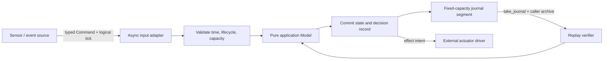

# RecoverTick


**Replay the failure. Bound the recovery. Keep the controller predictable.**

RecoverTick is a small Rust decision engine for embedded controllers, robotics
and simulation. A pure application model proposes typed state transitions and
effect intents. The engine owns logical time, bounded retries, terminal fallback
and an allocation-free decision journal.

This is a working 0.1.0 MVP. It does not claim safety certification, hardware
recovery, durable logging or a measured MCU worst-case execution time.

## Five-line quick start

The bundled `Motor` is a simulation model. In your controller, implement `Model`
with your own `State`, `Event`, `Fault` and `Effect` types.

```rust
use recovertick::{demo::{Motor, MotorEvent, MotorState}, Command, Engine, Policy, Transition};
let policy = Policy::new(2, 3)?;
let fallback = Transition::silent(MotorState::Stopped);
let mut engine = Engine::<Motor, 16>::new(Motor, MotorState::Idle, policy, fallback)?;
let decision = engine.dispatch(Command::event(1, MotorEvent::Start))?;
assert_eq!(decision.after.state, MotorState::Running);
```

Run the complete fault/recovery/replay example:

```sh
cargo run --example motor --locked
```

```text
tick 1: Scheduled { fault: Unavailable, attempts: 0, retry_at: 4 }
tick 4: Scheduled { fault: Unavailable, attempts: 1, retry_at: 7 }
tick 7: Applied { effect: Some(Drive) }
replay verified: Running
```

## Install

The supplied source is ready to use as a local dependency:

```toml
[dependencies]
recovertick = { path = "../recovertick" }
```

After the maintainer publishes the crate, use `recovertick = "0.1"`.
No crates.io publication or GitHub repository is implied by this source bundle.
The crate has no runtime, build or development dependencies; all library code
uses `core`. Host examples and the benchmark use `std`.

## Architecture



`src/model.rs` defines the public contracts. `src/engine.rs` owns lifecycle and
commit rules. `src/journal.rs` owns storage; `src/replay.rs` recomputes decisions.
Drivers and clocks stay outside the engine, so the same input trace can run on
a workstation or MCU with the same model version and policy.

## Recovery and error semantics

* Ticks are caller-defined `u64` units. Equal ticks are accepted; backwards ticks
  are rejected. The engine never reads a wall clock.
* `max_retries` counts additional evaluations after the original failure.
  A budget of zero commits fallback on the first fault.
* A failed reducer leaves domain state unchanged and retains its event.
  `Command::retry(tick)` reevaluates that event once at or after its deadline.
  Fresh events cannot replace it while recovery is pending.
* Exhaustion or deadline overflow commits the configured fallback and halts the
  engine. Its optional effect intent is returned in that one terminal decision.
  Further commands are rejected. Start a new engine for a new session.
* Application faults are `Outcome::Scheduled` or `Outcome::Halted`. Invalid
  commands return `DispatchError` without changing time, state, counters or log.
* One accepted command appends one record. A full segment returns `TraceFull`
  before calling the application reducer.

The retry mechanism retries **decisions**. It does not retry asynchronous I/O or
ensure exactly-once delivery of effects. A returned intent must still be applied
by your driver; represent driver acknowledgements as application events when
needed. Session-local record sequence numbers are useful for deduplication but
are not globally unique operation identifiers.

## Async input and cancellation

```rust
let command = core::future::ready(Command::event(1, MotorEvent::Start));
let record = engine.dispatch_async(command).await?;
```

Use any executor to await your input future. The engine waits only for the input
and then calls synchronous dispatch without another await. Dropping the future
while input is pending leaves the engine unchanged. Queue consumption and input
source cancellation are the source's responsibility. There is no background
task, executor dependency or busy retry loop.

## Archive and replay

```rust
let segment = engine.take_journal(); // State and global sequence are preserved.
let replayed = recovertick::verify_replay::<Motor, _, 1>(
    Motor, MotorState::Idle, policy, fallback, segment.iter(),
)?;
```

Archive each returned segment before dropping it if you need complete session
replay. Chain segment iterators in order and replay from the explicit original
state with the original model, policy and fallback. The verifier checks sequence,
input, full before/after snapshots and outcome, using bounded workspace.
Missing prefixes, gaps and recomputation mismatches fail.

A matching trace prefix is valid; detecting a missing tail requires an external
expected count or manifest. Records have ordinary Rust memory layout, not a
stable binary format. Verification is semantic, not cryptographic authentication.
An application model with hidden mutable state, clocks, randomness or I/O violates
the purity contract; `&self` alone cannot enforce determinism.

## Performance and resource bounds

The engine allocates no heap memory and forbids unsafe code. Dispatch performs
one reducer evaluation and a bounded amount of bookkeeping independent of log
capacity. Actual cost also depends on the size of copied application types.
Journal RAM grows linearly with capacity; `take_journal` may initialize/move a
whole segment, and callers must budget archive buffers and stack usage.

See [measured host layouts, benchmark method and unverified MCU targets](docs/PERFORMANCE.md).
For a reproducible local report:

```sh
cargo run --release --example footprint --locked
cargo bench --bench dispatch --locked
```

## Verify and contribute

```sh
cargo fmt --all -- --check
cargo clippy --all-targets --locked -- -D warnings
cargo test --all-targets --locked
cargo test --release --all-targets --locked
cargo test --doc --locked
cargo check --lib --target thumbv7em-none-eabihf --locked
cargo package --locked --allow-dirty
```

Install the embedded target with
`rustup target add thumbv7em-none-eabihf --toolchain 1.85.1`.
The toolchain file pins the development compiler; CI also checks current stable.
See [contribution rules](CONTRIBUTING.md) and
[research, architecture and Codex work blocks (Turkish)](docs/MARKET_AND_SPEC.tr.md).

## CI and release

The included workflow checks formatting, Clippy, debug/release tests, doctests,
docs, Linux/Windows/macOS, MSRV, Cortex-M and package publication dry-run.
Actions use verified commit pins and read-only default permissions.

Place this project at your GitHub repository root, use branch `main`, commit
`Cargo.lock`, and add a crate-scoped `CARGO_REGISTRY_TOKEN` Actions secret.
Set real repository/documentation URLs in `Cargo.toml` after creating the repo.
Enable a CI status badge using your real repository identity at that point.
Confirm crate-name availability before the first release.

To publish, bump the package version and changelog, commit to `main`, then push
the matching `vMAJOR.MINOR.PATCH` tag pointing to the current `main` commit.
Only a pushed tag with every check passing can publish the crate and create a
GitHub release with its archive and SHA-256. A retried publication skips an
already published version only if its checksum matches; a conflict requires
a new version. Crates.io versions are immutable. CI itself has not been run
on GitHub for this local bundle.

## License

Dual licensed under [MIT](LICENSE-MIT) or [Apache-2.0](LICENSE-APACHE).

