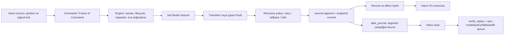

# RecoverTick — pazar analizi ve mimari şartname

Araştırma tarihi: **5 Ekim 2026**. Teslim: dış bağımlılıksız, `no_std` Rust MVP çekirdeği. İsimler çalışma adıdır; puanlar hedef kitlenin genişliği, demonstrasyon gücü, entegrasyon maliyeti ve teknik farklılaşmaya dayanan öznel değerlendirmelerdir. Yıldız sayısı veya GitHub Trending sonucu öngörmezler. Aşağıdaki fırsat değerlendirmeleri, incelenen birincil kaynaklardan yapılan çıkarımlardır; piyasadaki tüm projeleri kapsayan bir yokluk kanıtı değildir.

## 1. Üç niş konsept

| Proje Adı | Çözdüğü Kritik Problem | Neden Benzeri Yok/Eksik? | Hedef Teknoloji Yığını (Tech Stack) | Yıldız Potansiyeli (1-10) |
|---|---|---|---|---|
| **RecoverTick** | Otonom kontrol döngülerinde sonsuz yeniden deneme, geriye giden zaman, kaydı sessizce kaybetme ve sahadaki hata kurtarma kararlarını tekrar üretememe. | FSM alanı boş değil: [statig](https://github.com/mdeloof/statig) `no_std`, heap kullanmayan FSM ve async handler; [sfsm](https://docs.rs/sfsm/latest/sfsm/) hata durumu ve tracing; [hsmc](https://docs.rs/crate/hsmc/latest) deterministik journal ve doğrulanmış kuyruk sunuyor. Fırsat, **sınırlı retry + açık logical time + fallback/halt + sabit kapasiteli segment kaydı + doğrulamalı replay** sözleşmesini küçük, bağımlılıksız bir çekirdekte birleştirmek. | Rust `no_std`, const generics, `core::future`; harici Embassy/Tokio veya bare-metal sürücüleri | **9/10** |
| **SaturaGuard** | Nicemlenmiş Edge AI modelinin gerçek sensör dağılımında clipping, DSP kayması veya kalibrasyon aralığı dışı girişlerle sessizce kötüleşmesi. | [CMSIS-NN](https://github.com/ARM-software/CMSIS-NN) Cortex-M inference kernel optimizasyonlarını; [LiteRT nicemleme şartnamesi](https://developers.google.com/edge/litert/quantization/quantization_spec) ölçek, zero-point ve operatör kısıtlarını; [River ADWIN](https://riverml.xyz/latest/api/drift/ADWIN/) dağılım değişimi tespitini çözüyor. Önerilen niş, modele gömülebilen sabit RAM'li fixed-point aktivasyon doygunluğu/kalibrasyon gözcüsü ve aynı cihaz izinin host üzerinde analizi. Alarm, tek başına doğruluk kaybını veya nedenini kanıtlamaz. | C11/Rust `no_std`, CMSIS-NN/TFLM hook'ları; Python host analiz aracı | **8/10** |
| **WireEpoch** | CAN/ROS2 verisi MQTT/WebRTC'ye taşınırken kaynak zamanı, saat alanı, sıra, freshness ve düşürülen örnek bilgisinin kaybolması. | [Zenoh ROS2/DDS bridge](https://github.com/eclipse-zenoh/zenoh-plugin-ros2dds) zaten topics/services/actions bağlantısını çözüyor; dokümantasyonu shared-memory uyumluluğu ve duplicate/looping trafik kısıtlarını açıklıyor. Fırsat, clock-domain/epoch, provenance ve bounded backpressure bilgisini dönüşüm boyunca açıkça koruyan low-copy veri çekirdeğinde. Protokol dönüşümü ve ağ sınırlarında uçtan uca zero-copy garantisi kurulmaz. | Rust ödünç alınmış frame'ler/buffer pool, SocketCAN, ROS2/DDS adaptörleri, MQTT5/WebRTC çıkışları | **8/10** |

**Seçim: RecoverTick.** Hata kurtarma sözleşmesini küçük bir MVP ile sınayabiliriz: bir motor isteği arızalanır, belirli tick'lerde yeniden denenir, bütçe bitince fallback kararı alınır ve aynı girdi arşivi host üzerinde doğrulanır. Robotik, MCU firmware ve dijital ikiz testleri aynı çekirdeği kullanabilir. Demo, kullanıcıya doğrudan anlamlı bir davranış gösterir; SDK veya protokol ekosistemine bağımlılık gerektirmez.

Yeni FSM, async desteği veya replay tek başına farklılaştırıcı değildir. `hsmc` bunların önemli bir kısmını zaten sunar; dokümante `journal` özelliği `Vec<TraceEvent>`, paket bağımlılıkları ise `heapless` ve `hsmc-macros` içerir. RecoverTick'in mevcut dar tezi, kaynak sınırı ve kurtarma davranışını görünür kılan, **heap kullanmayan sabit segmentler ve sıfır runtime/build/dev paket bağımlılığıdır**. Sınırlı işlevi avantaj olarak göstermek için sözleşmelerin ve performansın ölçülmesi gerekir. [hsmc paket ve özellik belgeleri](https://docs.rs/crate/hsmc/latest)

GitHub plugin'i ile depo adı araması ve rakip README okumaları yapıldı. `RecoverTick` ve `WireEpoch` için `in:name` aramasında eşleşme görülmedi; bu, marka veya crates.io adının uygunluğunu kanıtlamaz. İlk düşünülen AegisTick adı, [mevcut AegisTick ürünü](https://voxel.shop/product/9050/aegis-tick) nedeniyle bırakıldı. Yayından önce gerçek depo ve paket kimliği doğrulanmalıdır.

## 2. API ergonomisi

Mevcut [demo modeli](../src/demo.rs) kullanıldığında kurulum ve tek olay işleme **beş satırdır**. Bu kod `?` kullanımını destekleyen bir fonksiyonda çalışır; çalıştırılabilir tam sürüm [examples/motor.rs](../examples/motor.rs) içindedir. Uygulamanın kendi durum/olay modeli ayrıca tanımlanır.

```rust
use recovertick::{demo::{Motor, MotorEffect, MotorEvent, MotorState}, Command, Engine, Policy, Transition};
let policy = Policy::new(2, 3)?; // İlk denemeye ek en çok 2 retry; aralık 3 logical tick.
let fallback = Transition::with_effect(MotorState::Stopped, MotorEffect::Disable);
let mut engine = Engine::<Motor, 16>::new(Motor, MotorState::Idle, policy, fallback)?;
let record = engine.dispatch(Command::event(1, MotorEvent::Start))?; // Karar kaydedildi.
```

`record.outcome` uygulanacak **effect niyetini** içerir. Motoru sürmek, pin değiştirmek veya ağ paketi göndermek dış sürücünün işidir. `dispatch` fiziksel I/O yapmaz.

Async sınır aynı çekirdeği kullanır. Bir async fonksiyon içindeki çağrı şöyledir:

```rust
// Hazır bir Future yalnızca örnektir; gerçek sürücü bir kanal veya cihaz kaynağı sunabilir.
let record = engine.dispatch_async(core::future::ready(Command::event(2, MotorEvent::Stop))).await?;
```

`dispatch_async` bir `Future<Output = Command<Event>>` bekler, ardından senkron `dispatch` çağırır. Async reducer, executor, timer veya arka plan task'i içermez. Girdi future'ı `Pending` iken bu future'ın düşürülmesi engine'i değiştirmez. Girdi kaynağının iptal sırasında kuyruktan olay tüketip tüketmediği kendi sözleşmesidir. Girdi hazır olduğunda doğrulama, reducer, kayıt ve commit arasında `await` yoktur. [Gerçek uygulama](../src/engine.rs)

### Kendi modelini tanımlamak

`Model` uygulamaya ait saf karar fonksiyonudur. Dört ilişkili tip `Copy + Eq` olmalıdır. Aşağıdaki örnekte hazır olma gözlemi olayda taşınır; retry aynı olayı daha sonraki logical tick ile değerlendirir.

```rust
use recovertick::{Model, Transition};

#[derive(Clone, Copy, Debug, PartialEq, Eq)]
enum LinkState { Closed, Open }
#[derive(Clone, Copy, Debug, PartialEq, Eq)]
enum LinkEvent { OpenAt { ready_at: u64 }, Close }
#[derive(Clone, Copy, Debug, PartialEq, Eq)]
enum LinkFault { NotReady }
#[derive(Clone, Copy, Debug, PartialEq, Eq)]
enum LinkEffect { Connect, Disconnect }
struct Link;

impl Model for Link {
    type State = LinkState;
    type Event = LinkEvent;
    type Fault = LinkFault;
    type Effect = LinkEffect;

    fn transition(
        &self,
        _state: LinkState,
        event: LinkEvent,
        tick: u64,
    ) -> Result<Transition<LinkState, LinkEffect>, LinkFault> {
        match event {
            LinkEvent::OpenAt { ready_at } if tick < ready_at => Err(LinkFault::NotReady),
            LinkEvent::OpenAt { .. } => Ok(Transition::with_effect(
                LinkState::Open, LinkEffect::Connect,
            )),
            LinkEvent::Close => Ok(Transition::with_effect(
                LinkState::Closed, LinkEffect::Disconnect,
            )),
        }
    }
}
```

Saflık sözleşmesi: reducer saat okumaz, rastgelelik kullanmaz, I/O yapmaz, gizli mutable duruma bağlı olmaz ve panic üretmez. Gereken dış gözlemler State/Event/tick değerlerine taşınır. Rust tip sistemi ve `&self`, interior mutability üzerinden saflık ihlalini bütünüyle engelleyemez; eşdeğer replay için uygulama bu sözleşmeyi korumalıdır. [Model API'si](../src/model.rs)

## 3. Mimari ve commit sözleşmesi



Bağımlılık yönü dış sürücüden public API'ye, engine'den model ve kayıt değerlerine gider. Model donanım veya runtime adaptörünü bilmez; replay aynı engine kararlarını yeniden hesaplar. Çekirdek tek sahibi olan `&mut Engine` ile yönetilir; lock, atomik kuyruk veya çoklu üretici zamanlaması içermez.

### Zaman, retry ve fallback

1. Yeni engine `tick = 0`, `Status::Active` ile başlar. Kabul edilen tick'ler **azalmayan** `u64` değerleridir; eşit tick kabul edilebilir. Duvar saati, zaman birimi ve MCU sayaç taşmasını genişletme dış sürücüye aittir.
2. `Command::Event` reducer'ı değerlendirir. Başarı, önerilen domain durumunu ve effect niyetini kaydeder. Domain fault normal kabul edilmiş karardır; `Outcome::Scheduled` veya `Outcome::Halted` üretir.
3. Fault sonrası domain state korunur; engine özgün olayı, son fault'u, kullanılan retry sayısını ve `retry_at` değerini saklar. `Recovering` sırasında yeni `Event` reddedilir; özgün olay başka gözlemle değiştirilemez.
4. `max_retries` **ilk denemeyi içermez**. Örneğin `Policy::new(2, 3)`, en çok bir ilk değerlendirme ve iki retry değerlendirmesidir. `max_retries = 0` ilk fault'ta fallback/halt üretir. `backoff_ticks = 0` yapılandırma hatasıdır.
5. Retry yalnızca `tick >= retry_at` olduğunda kabul edilir. Erken retry, recovery yokken retry, geriye giden tick ve halted engine'e komut reddedilir. Bütün retler engine'i ve journal'ı değiştirmeden döner.
6. Son izinli retry da başarısız olursa `RetryBudgetExhausted`; sonraki deadline için `checked_add` taşarsa `DeadlineOverflow` ile fallback state/effect niyeti kaydedilir ve engine terminal `Halted` durumuna geçer. Yeniden başlatma yeni engine/session gerektirir.

Bu mekanizma retry sayısını sınırlar; caller'ın retry komutunu ne zaman göndereceğini veya reducer çalışma süresini sınırlandırmaz. Süresiz komut bekleme ya da blocking reducer için hard real-time garanti vermez. [Engine ve policy](../src/engine.rs), [typed hata ve sonuçlar](../src/model.rs)

### Segment kaydı, süreklilik ve replay

`Journal<R, N>`, `[Option<R>; N]` içinde append-only kabul edilmiş karar kaydı tutar. Her record session sıra numarası, command, önceki/sonraki snapshot ve outcome içerir. Retler bu journal'a yazılmaz. `N = 0` yapılandırma hatasıdır; kapasite dolduğunda `TraceFull` reducer çağrısından ve state değişiminden önce döner. Kayıt üzerine yazma ve sessiz kayıp yoktur. [Journal](../src/journal.rs)

`take_journal()` dolu veya kısmi segmentin sahipliğini caller'a verir ve engine'e boş segment koyar. Domain state, son kabul edilmiş tick ve **global session `u64` sequence** korunur. Böylece arşivlenen segmentlerle uzun oturum sürer; arşivleme gecikirse kapasite backpressure uygular. `SequenceExhausted`, sıra sayacının taşmasını önler. Sahiplik devri kalıcı yazma veya arşiv onayı değildir; tam oturum replay'i için caller aldığı segmentleri saklamalıdır. Engine alınmış segmenti yeniden teslim edecek bir archive acknowledgement protokolü uygulamaz.

`verify_replay` arşiv segmentlerinin sırayla birleştirildiği iterator'ı kabul eder. **Açık ilk domain state**, aynı saf model, policy ve fallback gerekir; fonksiyon session başındaki tick sıfır ve sequence sıfırdan yürür. Sequence, before/after snapshot ve outcome yeniden hesaplanan record ile eşit olmalıdır. Başlangıç eksikliği, sıra boşluğu, değişen sonuç veya snapshot sapması doğrulamayı başarısız kılar. Geçerli bir prefix ve boş kayıt akışı kabul edilir; eksik son kayıtları saptamak için beklenen record sayısı veya güvenilen oturum sonu bilgisi dışarıdan verilmelidir. [Replay verifier](../src/replay.rs)

Replay **semantik doğrulamadır**: kimlik doğrulama, kriptografik bütünlük, imzalı arşiv, sürümlü wire format veya fiziksel I/O tekrarı değildir. Record'ların Rust bellek yerleşimi taşınabilir dosya formatı sayılmaz. Aynı girişlerin eşit kararları üretmesi, dış actuator komutunun tam bir kez yürütüldüğünü kanıtlamaz; effect'in başarısızlığı, tekrar teslimi ve idempotency dış driver tarafından modellenmelidir.

## 4. Modüler dizin yapısı

```text
recovertick/
├── Cargo.toml                 # Sıfır runtime/build/dev paket bağımlılığı
├── Cargo.lock
├── rust-toolchain.toml
├── src/
│   ├── lib.rs                 # no_std, unsafe yasağı, public API
│   ├── model.rs               # Model, command, policy, snapshot, fault/error tipleri
│   ├── engine.rs              # Doğrulama, recovery, append ve commit, async girdi sınırı
│   ├── journal.rs             # Sabit kapasiteli append-only segment
│   ├── replay.rs              # Kabul edilen kayıtları yeniden hesaplayarak doğrulama
│   └── demo.rs                # Donanım gerektirmeyen motor modeli
├── tests/
│   ├── edge_cases.rs          # Public API, recovery ve replay sınırları
│   └── async_adapter.rs       # Poll/iptal ve async hata davranışı
├── examples/
│   ├── motor.rs               # Fault / recovery / replay oturumu
│   └── footprint.rs           # size_of ölçümü
├── benches/
│   └── dispatch.rs            # Bağımlılıksız host microbenchmark
├── scripts/
│   └── release_check.py       # Manifest, tag ve yayımlama tekrar kontrolü
├── .github/
│   ├── workflows/ci.yml       # Stil, lint, test, no_std, paket ve tag release
│   └── dependabot.yml         # Action pin güncellemeleri
├── docs/
│   ├── MARKET_AND_SPEC.tr.md  # Bu şartname
│   └── PERFORMANCE.md         # Gerçek ölçümler ve hedeflerden farkları
└── README.md                  # Kurulum, hızlı başlangıç, mimari ve katkı akışı
```

## 5. Performans bütçesi ve bağımlılık politikası

| Ölçüt | MVP sözleşmesi veya hedefi | Doğrulama yöntemi |
|---|---|---|
| Heap allocation | Çekirdekte **0**; `alloc`/heap koleksiyonu yok | Kaynak incelemesi ve embedded `no_std` build |
| Paket bağımlılığı | Runtime, build ve dev için **0** üçüncü taraf Cargo paketi | Manifest/lock ve release script kontrolü; standart `core` üçüncü taraf paket değildir |
| Unsafe | `#![forbid(unsafe_code)]` | Derleyici; uygulamanın ayrı donanım driver'ı bu crate'in kapsamı dışındadır |
| RAM | Demo `Engine<Motor, 16>` için **≤ 4 KiB hedef**; gerçek değer ABI ve model tiplerine bağlı | `cargo run --example footprint`; [ölçüm notları](PERFORMANCE.md) |
| Flash | Cortex-M4F, 120 MHz üzerinde engine'e bağlanmanın **< 8 KiB ilave flash hedefi** | Aynı firmware/toolchain/link ayarlarıyla engine'li ve engine'siz linked image farkı; firmware, driver ve runtime hariç |
| Latency | Aynı hedef kartta trivial demo reducer ile `dispatch + record` **p99 < 10 µs hedefi** | Hardware cycle counter ile yeterli örnek, ölçüm overhead'i ve derleyici ayarları raporlanmalı |

**Cortex-M flash ve latency değerleri hedeflerdir; bu MVP tesliminde donanım üzerinde doğrulanmış sonuçlar değildir.** Embedded cross-check donanım zaman ölçümü veya linked firmware boyutu ölçümü yerine geçmez. Host benchmark da Cortex-M p99 değerini kanıtlamaz. Test edilmiş ölçümler, ortamlarıyla birlikte [PERFORMANCE.md](PERFORMANCE.md) içindedir.

Model, State/Event/Fault/Effect boyutları ve kopyalama maliyetleri sabit kabul edildiğinde engine dispatch yolu **O(1)**; application reducer'ın maliyeti ayrıca eklenir. Journal RAM'i **O(N)** ve record boyutuyla ölçeklenir. `take_journal()` array başlatma/kopyalama nedeniyle **O(N)** iş ve geçici stack alanı gerektirebilir; ownership move, zero-copy garantisi değildir.

K kayıt doğrulaması **O(K)**, verifier workspace'i **O(N)**'dir; başlangıçta N slotlu journal kurulması O(N) olabilir. Replay her kayıt sonrası yalnızca o tek doğrulanmış slotu temizler; N slotu her kayıt için yeniden başlatmaz. Önerilen `verify_replay::<M, _, 1>` çağrısı workspace'i bir kayıtla sınırlar. Kopyalanan değerlerin boyutu ve model değerlendirmesi ek maliyettir. Harici arşivin belleği çekirdeğin bounded RAM bütçesine dahil değildir.

## 6. Test mimarisi ve kabul ölçütleri

Sözleşme testleri gerçek public API'yi kullanır. Pure reducer, logical tick ve kaydedilmiş input/outcome eşitliği sayesinde testler gerçek saat, uyku, ağ veya donanım gerektirmez. Sayımlar ve fiilen koşturulan komutlar teslimde ayrıca raporlanır; aşağıdaki tablo test edilecek davranışın tanımıdır.

| Kritik senaryo | Beklenen sonuç |
|---|---|
| Sıfır kapasite veya sıfır backoff | Typed `ConfigError`; geçersiz engine/policy oluşmaz |
| Tick geriye gider | `TimeWentBackwards`; snapshot ve kayıt sayısı korunur |
| Deadline öncesi retry / recovery sırasında yeni olay | `RetryTooEarly` / `RecoveryPending`; özgün event ve deadline korunur |
| `max_retries = 0` ve retry bütçesinin tam sınırı | İlk değerlendirme retry sayılmaz; exhaustion tam belirlenen değerlendirmede fallback/halt üretir |
| `u64` deadline taşması | Wraparound yerine `DeadlineOverflow`; fallback record'u yazılır |
| Journal dolu | `TraceFull`; reducer çağrılmaz, engine/journal değişmez |
| Segment devri sonrası oturum | State/tick ve global sıra korunur; segmentlerin birleştirilmiş replay'i eşleşir |
| Değiştirilmiş kayıt veya sıra boşluğu | `ReplayError::Diverged`; ilk sapma index'i raporlanır |
| Geçerli prefix | Kabul edilir; tail eksikliği için caller'ın dış record-count kontrolü gerekir |
| Async girdi `Pending` iken drop | Engine ve journal değişmez; input kaynağının tüketim sözleşmesi ayrıdır |
| Async girdi hazır | Sync dispatch ile aynı record/outcome üretilir |

Entegrasyon senaryosu motor modelinin gecikmeli hazır oluşunu, failure→retry→success veya failure→fallback zincirini, effect niyetlerini, segment arşivini ve replay son durumunu birlikte doğrular. Replay doğrulaması effect'i yeniden fiziksel I/O olarak yürütmez.

## 7. CI/CD ve GitHub otomasyonu

Mevcut [ci.yml](../.github/workflows/ci.yml), `main` push/PR için format ve Clippy'yi; Linux/macOS/Windows üzerinde debug, release, doctest ve warning'siz rustdoc'u; Rust 1.85.1 MSRV işini; `thumbv7em-none-eabihf` `no_std` cross-check'i; manifest/package/publish dry-run kontrolünü tanımlar. Workflow'un tanımlanması, GitHub üzerinde çalışmış olduğu anlamına gelmez.

`v*` tag push aynı kalite işleri başarılı olunca release işini açar. [release_check.py](../scripts/release_check.py), tag ile Cargo sürümünün tam eşleşmesini ve sıfır paket bağımlılığını denetler. Release ayrıca tag commit'inin o anda remote `main` commit'ine eşit olmasını ister; crates.io yüklemesini ve checksum'lu GitHub Release'i yürütür. Tekrar koşuda mevcut registry sürümü yalnızca aynı archive checksum'una sahipse atlanır. Paket adı sahipliği, gerçek GitHub deposu ve yayınlama yetkisi ayrıca gereklidir; mevcut çalışma dizini bu kimlikleri oluşturmuş veya paket yayımlamış değildir.

Action commit pin'leri [Dependabot](../.github/dependabot.yml) üzerinden güncellenir. Test işleri salt okunur repository yetkisi, release işi gereken yazma yetkisi ile tanımlıdır. İlk gerçek release öncesinde depo `CARGO_REGISTRY_TOKEN` secret'ı ve crates.io paket sahipliği kurulmalıdır. Manuel workflow çalıştırma publish koşulunu sağlamaz. Workflow sürüm numarasını kendi artırmaz; Cargo sürümü güncellemesi ve eşleşen tag ile **yayınlama** otomatikleşir.

## 8. Codex için modüler uygulama blokları

| Blok | Dosyalar / sözleşme | MVP'de durum | Sonraki genişletmenin sınırı |
|---|---|---|---|
| B1 — Domain API | [model.rs](../src/model.rs): `Model`, dört `Copy + Eq` tip, `Command`, `Policy`, snapshot ve typed hata | Uygulandı | Hiyerarşik/ortogonal statechart veya macro DSL mevcut değil |
| B2 — Deterministik engine | [engine.rs](../src/engine.rs): validation, fixed backoff, retry bütçesi, overflow fallback, terminal halt | Uygulandı | Hardware timer, automatic retry scheduling, preemption ve çoklu producer kuyruğu mevcut değil |
| B3 — Bounded trace | [journal.rs](../src/journal.rs): append-only segment, `TraceFull`, ownership transfer, global sequence | Uygulandı | Kalıcı arşiv acknowledgement, crash recovery veya portable serialization mevcut değil |
| B4 — Replay verifier | [replay.rs](../src/replay.rs): aynı model/policy/fallback/ilk durumla iterator stream doğrulama | Uygulandı | Authenticated trace veya güvenilen tail-count protokolü mevcut değil |
| B5 — Async sınır | [engine.rs](../src/engine.rs): `Future<Command>` → synchronous dispatch | Uygulandı | Embassy/Tokio adaptör crate'leri, async reducer ve I/O transaction mevcut değil |
| B6 — Örnek ve doğrulama | [demo.rs](../src/demo.rs), [motor.rs](../examples/motor.rs), `tests/`, [host benchmark](../benches/dispatch.rs), [footprint](../examples/footprint.rs) | MVP örnek/ölçüm/test yüzeyi | Hardware-in-the-loop ve Cortex-M p99/flash ölçümü sonraki iş |
| B7 — Release hattı | [ci.yml](../.github/workflows/ci.yml), [release_check.py](../scripts/release_check.py), [README](../README.md) | Workflow ve yayınlama kontrolleri üretildi | Gerçek repository/paket kimliği ve ilk yayın bağlantılı hesapta ayrıca kurulmalı |

MVP, belli model ve sürücü sözleşmeleri altında deterministik **karar** çekirdeğidir. Güvenlik sertifikası, formal proof, actuator güvenliği, ağ teslim garantisi veya fiziksel I/O transaction sunmaz. Üretimdeki bütün sistem değerlendirmesi; model, driver, scheduler, fault gözlemleri ve donanım davranışını da kapsamalıdır.

## 9. Yol haritası

1. **Ölçüm kapısı:** Cortex-M4F hardware-in-the-loop, gerçek linked flash farkı ve p99 latency; hedefleri sağlanmadığında raporlayıp optimize et.
2. **Arşiv protokolü:** Sürümlü portable codec, model/policy kimliği ve expected-count/trusted-end kaydı; crash recovery ihtiyacını ayrıca tasarla.
3. **Driver adaptörleri:** Ayrı Embassy/Tokio crate'leri ve dış scheduling örnekleri; çekirdeğin sıfır bağımlılık sınırını koru.
4. **Effect teslim sözleşmesi:** Command ID, deduplication ve transactional outbox gerektiğinde ayrı katmanda tasarla; fiziksel I/O için exactly-once iddiası kurma.
5. **Robotik entegrasyon:** ROS2/CAN fault gözlemlerini Event değerlerine dönüştüren örnek; protokol köprüsü veya sentetik sensör üreticisini bu MVP'ye mevcut özellik gibi ekleme.
